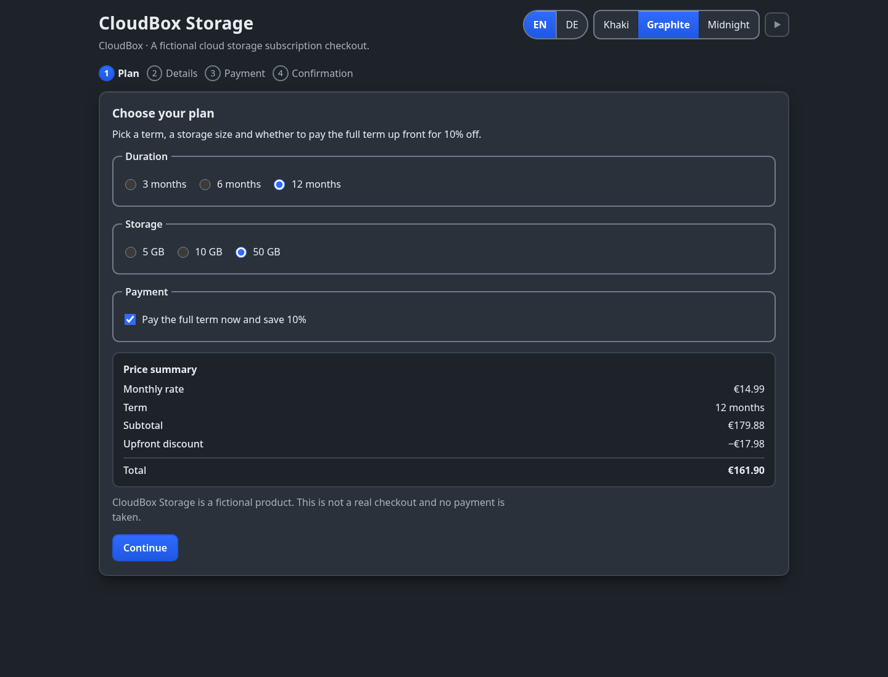
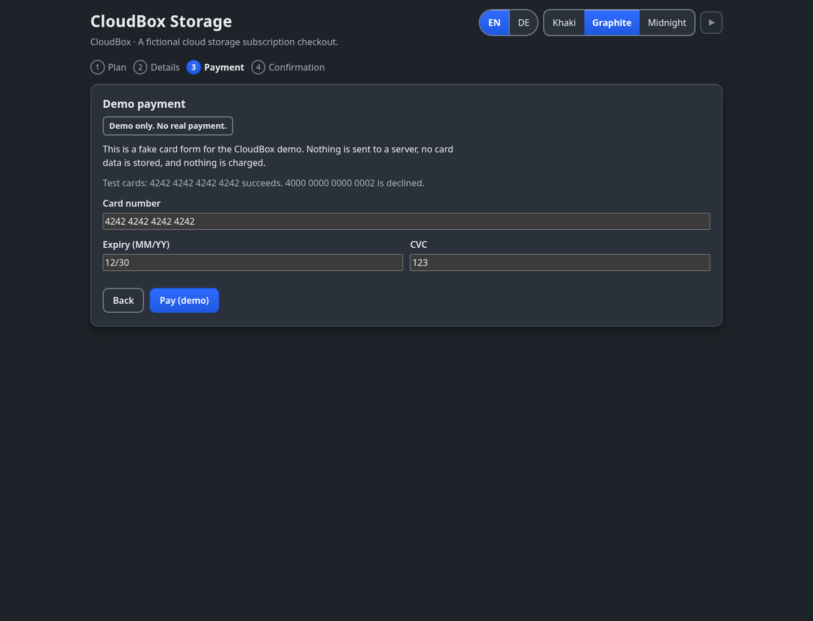
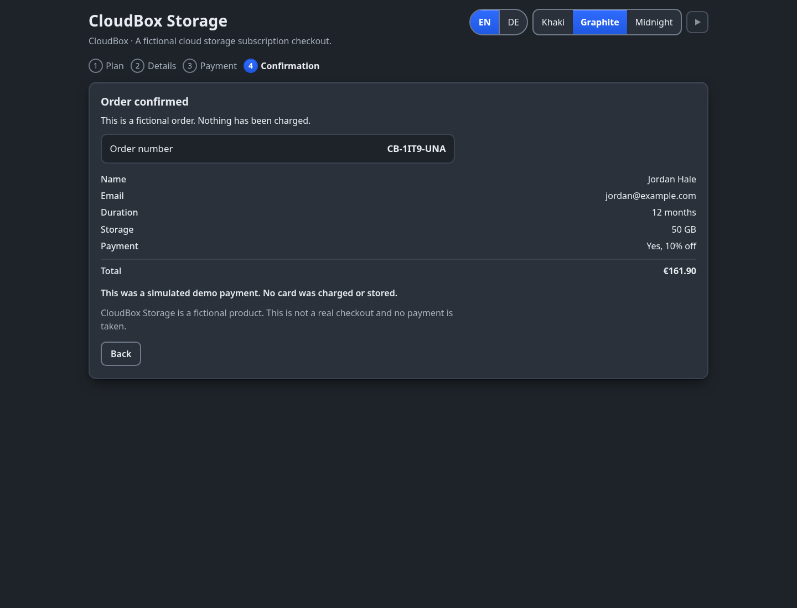

# CloudBox Storage

**Live: https://ali1129js.github.io/subscription-checkout/**

A subscription checkout for the fictional product **CloudBox Storage**. This is a demo. No real account is created and no payment is taken. Any resemblance to real products or companies is coincidental.







## Features

- Four-step checkout: plan, details, demo payment and confirmation, with a progress indicator.
- Duration (3, 6 or 12 months), storage (5, 10 or 50 GB) and an optional 10% upfront discount, priced in integer euro cents.
- A live price summary updates as the plan changes.
- Name, email and terms are validated with Zod. Inline errors block the next step until the form is valid.
- A clearly labelled fake card form with Luhn, expiry and CVC checks. 4242 4242 4242 4242 succeeds; 4000 0000 0000 0002 is declined. Card data is never stored or sent.
- Wizard state is kept in `sessionStorage` and the current step is in the URL, so a refresh does not lose the checkout. Card fields are not part of that state.
- A confirmation screen shows a fictional order number and the plan summary.
- Three gloss themes (Khaki, Graphite, Midnight; Graphite is the default), a motion toggle that stays off until you turn it on, and English or German.

## Stack

Vite, React 19, TypeScript (`strict`, `noUncheckedIndexedAccess`, `exactOptionalPropertyTypes`), Zod, Vitest and Testing Library. Deployed to GitHub Pages from an Actions workflow.

## Getting started

```bash
npm install
npm run dev
npm test
npm run lint
npm run typecheck
npm run build
npm run guard
```

## Learning notes

See [docs/LEARN.md](docs/LEARN.md) for short explanations of money in integer cents, wizard state, and form validation.

## License

MIT
